  

  
  
  

## About Me

I'm **Lucky Ram**, a full-stack developer working with **PHP, Laravel, Filament and Node.js**.

- Building software in the **Healthcare** and **Finance** domains
- Admin panels, REST APIs, third-party integrations and backend automation
- Interested in **EMR automation**, custom EMRs and **EVV integrations** for US healthcare
- Using **agentic AI** (Claude Code + MCP) to build and test faster, with every change reviewed
- **Open to freelance projects** — contact.luckyram@gmail.com

## Projects & Guides

| Repository | Description |
| --- | --- |
| 💊 [**pharmacy-inventory-filament**](https://github.com/contact-luckyram/pharmacy-inventory-filament) | Pharmacy inventory & billing admin panel (Laravel 13 + Filament 5) · [Live demo](https://medistock-xiyz.onrender.com/admin) |
| ⚡ [**laravel-filament-guide**](https://github.com/contact-luckyram/laravel-filament-guide) | Why Filament is the best Laravel admin framework, its structure, and installation |
| 🧩 [**laravel-filament-modules**](https://github.com/contact-luckyram/laravel-filament-modules) | Modular Laravel + Filament setup with nwidart/laravel-modules |
| 🔭 [**laravel-telescope-guide**](https://github.com/contact-luckyram/laravel-telescope-guide) | Install and use Laravel Telescope to monitor requests, queries, jobs and more |
| 🚨 [**laravel-sentry-guide**](https://github.com/contact-luckyram/laravel-sentry-guide) | Integrate Sentry with Laravel for real-time error alerts and monitoring |

## Tech Stack

  

  
  
  
  
  

